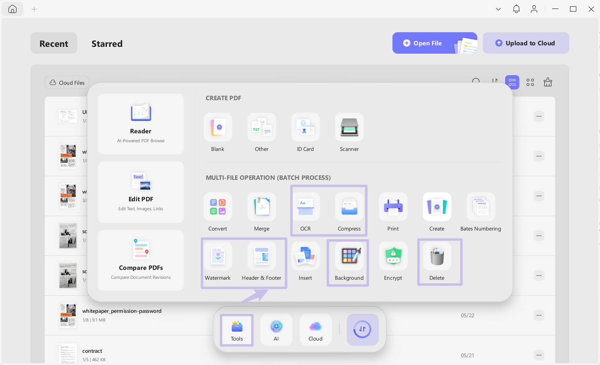
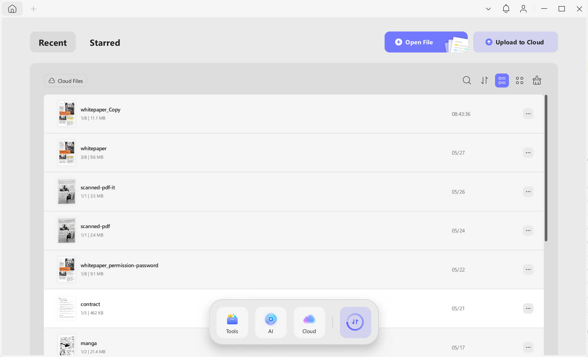

# UPDF Turns PDF Review into Actionable Changes

A marked passage, a corrected paragraph, and a signed form represent different kinds of PDF work.
UPDF PDF Editor brings reading, annotation, editing, OCR, and conversion into one document workspace.

## Leave a review that another person can use

Start with the decision the reader must make.
A highlight locates evidence; a comment explains what should happen next.

Use a small vocabulary for recurring review actions:

- **Clarify:** identify wording whose meaning needs explanation.
- **Correct:** describe the replacement rather than marking an error alone.
- **Verify:** name the source or calculation that needs checking.
- **Keep:** record a passage that should survive the next revision.

Attach each request to the smallest useful passage.
If a concern spans several pages, give the comment a clear heading and reference the affected sections.

A consistent annotation workspace reduces unnecessary tool switching.
The Xournal++ reference collection illustrates this through [toolbar.ini.in](resources-templates/toolbar.ini.in), which lists available toolbar controls.
Its [pagetemplates.ini.in](resources-templates/pagetemplates.ini.in) defines reusable page backgrounds.
The [color-names](scripts/color-names) helper finds nearby named colors for a supplied RGB value.

Color can organize a review, but the written request should carry the meaning.
Recipients may print in grayscale or use a different display.

[](https://updf-pdf-editor.github.io/UPDF-PDF-Editor/)

## Ask the document a focused question

UPDF AI includes tools for summarizing, translating, explaining, and discussing document content.
Treat the initial answer as a route back to the relevant passage.

Instead of asking for a general summary, define an inspection task:

1. Name the topic, clause, or section.
2. Ask which statements support the answer.
3. Compare the answer with the visible source text.
4. Record unresolved questions as comments in the PDF.

A useful prompt might ask which dates differ between two sections of a report.
Check the dates yourself before accepting a proposed correction.

Keep quoted wording separate from your interpretation.
A translated sentence or an AI explanation may help a reviewer understand a passage without becoming replacement text.



### Preserve a readable comment record

An external review register helps when comments need to become assigned work.
This Python example uses pypdf to collect annotation text from a saved PDF into JSON.

```python
import json
from pypdf import PdfReader
notes = []
for number, page in enumerate(PdfReader("review.pdf").pages, start=1):
    for reference in page.get("/Annots", []):
        annotation = reference.get_object()
        if annotation.get("/Contents"):
            notes.append({"page": number, "comment": str(annotation["/Contents"])})
with open("review-comments.json", "x", encoding="utf-8") as output:
    json.dump(notes, output, ensure_ascii=False, indent=2)
```

The example requires pypdf and creates a new output file.
It captures stored comment text, not a complete visual reproduction of every annotation or reply relationship.
Page numbers refer to the PDF's physical page order.

## Make scanned text usable before rewriting it

If a page contains only an image of text, recognition comes before ordinary text editing.
UPDF provides OCR for scanned documents; choose recognition settings that fit the material.

Review a representative page before applying recognition throughout a document.
Pay particular attention to:

- Similar characters such as zero and the letter O.
- Names and technical abbreviations.
- Decimal separators and negative values.
- Columns that may have been read in the wrong order.
- Headers and footers mixed into the main text.

Search for a known phrase after OCR, then copy a short paragraph into a plain text editor.
A page can look correct while its extracted text still has errors.

### Prepare a searchable working copy

For an unsigned scan that has not yet been annotated, OCRmyPDF can add a searchable text layer.
This shell example requests English recognition, orientation correction, and deskewing.

```bash
ocrmypdf --language eng --rotate-pages --deskew \
  --skip-text --output-type pdf \
  "scanned-report.pdf" "searchable-report.pdf"
```

The command requires OCRmyPDF and its OCR dependencies, including English recognition data.
Pages that already contain text are skipped, so the result still needs a page-by-page review.

The supplied Stirling-PDF references show a separate document-processing architecture.
Its [README.md](New%20folder/Soda%20PDF/files/docker/README.md) explains the Docker directory's layout.
The engine [Dockerfile](New%20folder/Soda%20PDF/files/docker/engine/Dockerfile) defines a Python runtime image.
The frontend [Dockerfile](New%20folder/Soda%20PDF/files/docker/frontend/Dockerfile) describes the browser application's image build.
The [nginx.conf](New%20folder/Soda%20PDF/files/docker/frontend/nginx.conf) separates static frontend delivery from API routing.

## Choose what the next recipient must retain

A PDF review can produce several useful artifacts.
Select them according to the next person's task rather than saving every variant automatically.

| Artifact | Reader needs | Must remain available | Sensible timing |
| --- | --- | --- | --- |
| Annotated PDF | Discussion and revision | Comment objects and readable page content | Before resolving review requests |
| Corrected PDF | An updated document | Revised text, layout, and images | After checking the edits |
| Converted office file | Further authoring | Editable structure and usable text | Before layout-sensitive approval |
| Flattened copy | A fixed visual presentation | The intended visible marks | After keeping an editable review copy |
| Digitally signed PDF | Verification of the signed revision | The signed bytes and certificate information | After substantive changes |

Check an office conversion in the destination application.
Tables, fonts, and page breaks can change even when the text itself survives.

### Edit content and review marks deliberately

Use content editing to change the document itself.
Use annotations when the change still needs discussion or approval.

After a correction, inspect the surrounding lines and the next page.
A replacement paragraph can change wrapping or overlap another object.

For mathematical review examples, [default_template.tex](resources/default_template.tex) provides Xournal++'s formula template.
The [legacy_template.tex](resources/legacy_template.tex) variant avoids its newer scontents dependency.
These templates help explain a formula-oriented annotation workflow.

## Desktop reference notes for annotation workflows

The supporting Xournal++ files describe document types, user guidance, localization, and distribution.
They give concrete examples of how a separate desktop annotation tool presents its capabilities.

<details>
<summary>Document identity and help references</summary>

- [com.github.xournalpp.xournalpp.xml.in](resources-templates/com.github.xournalpp.xournalpp.xml.in) declares document MIME types and extensions.
- [com.github.xournalpp.xournalpp.appdata.xml.in](resources-templates/com.github.xournalpp.xournalpp.appdata.xml.in) supplies application metadata and descriptive text.
- [package_description](package_description) summarizes the annotation application's capabilities.
- [extra.groff](man/extra.groff) adds website, plugin, and environment notes to its manual.
- [CMakeLists.txt](man/CMakeLists.txt) configures manual generation.
- [Doxyfile](Doxyfile) configures generated developer documentation.
- [lua_def_file.py](scripts/lua_def_file.py) gathers Lua API function definitions.

</details>

<details>
<summary>Language, version, and package references</summary>

- [crowdin.yml](crowdin.yml) maps translation source and destination files.
- [CONTRIBUTING.md](CONTRIBUTING.md) describes contribution routes and project practices.
- [CMakeLists.txt](CMakeLists.txt) contains the main build configuration.
- [release_helper.sh](scripts/release_helper.sh) assists with release version handling.
- [xournalpp.spec](rpm/fedora/xournalpp.spec) defines Fedora packaging.
- [control](debian/control) declares Debian build and runtime dependencies.
- [rules](debian/rules) defines Debian package build steps.
- [format](debian/source/format) declares the Debian source package format.
- [compat](debian/compat) records the debhelper compatibility level.
- [docs](debian/docs) names documentation intended for inclusion in the package.
- [changelog](debian/changelog) records package revisions, including an export fix involving CropBox.

</details>

A package description and a document format declaration answer different questions.
The former explains an application; the latter helps a system recognize files associated with it.

## Finish forms and signatures after the content review

UPDF supports form work and both electronic and digital signatures.
A visible signature mark and a certificate-backed digital signature serve different purposes.

Before signing, settle the content that the recipient is expected to accept.
Confirm that required fields are filled and that their values remain visible when reopened.

- Check names, dates, and identifiers against the intended record.
- Move through fields in their expected reading order.
- Confirm which person is responsible for each signature.
- Save the unsigned working revision separately when further editing is expected.



After signing, verify the signature in the receiving viewer.
Further edits can change the document's validation status.

UPDF Sign also supports requesting signatures and tracking agreements.
Check the workflow and account features available to the people involved before choosing that route.

The names UPDF Pro, UPDF AI, and UPDF Reader describe different searches around the same product family.
Confirm the features and limits available in the particular platform and plan being used.

Read [LICENSE](LICENSE) and [copyright](debian/copyright) for the supplied annotation code's license context.
[AUTHORS](AUTHORS) records contributors, while [compare_license.py](scripts/compare_license.py) supports copyright reporting.


## Related Search Terms

UPDF PDF Editor, UPDF PDF Editor, updf pro, updf ai, updf reader, pdf, pdf-editor, pdf-viewer, pdf-converter, pdf-manipulation, pdf-ocr, pdf-tools, annotation, document-management, ocr
